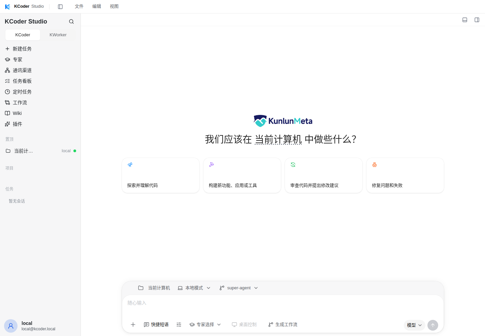
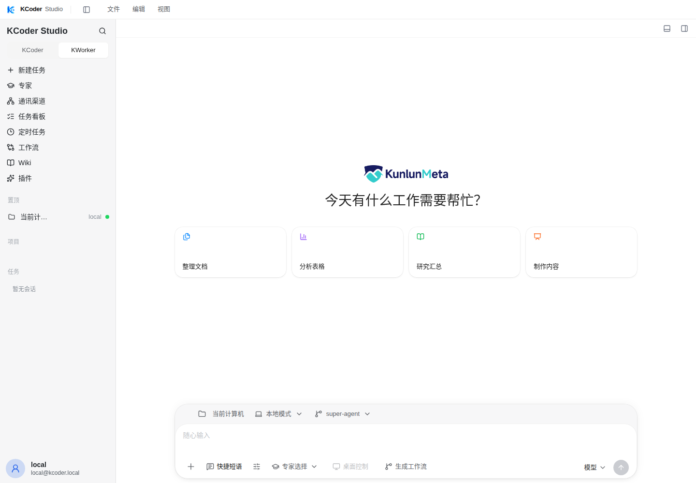
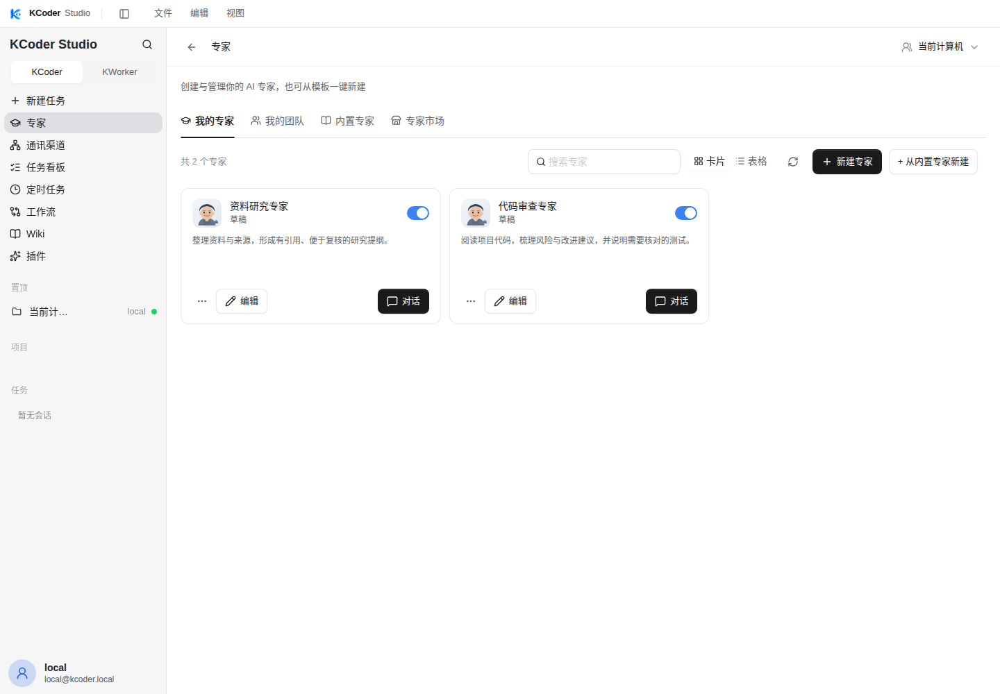
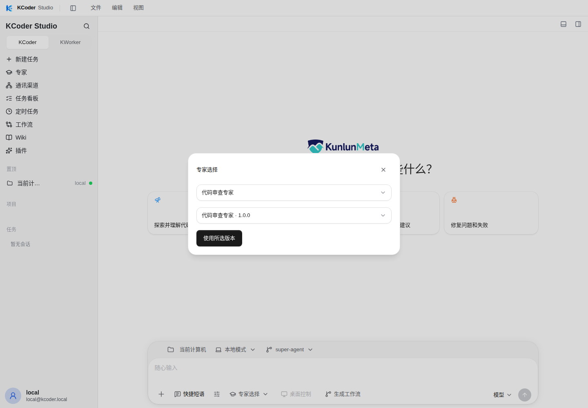
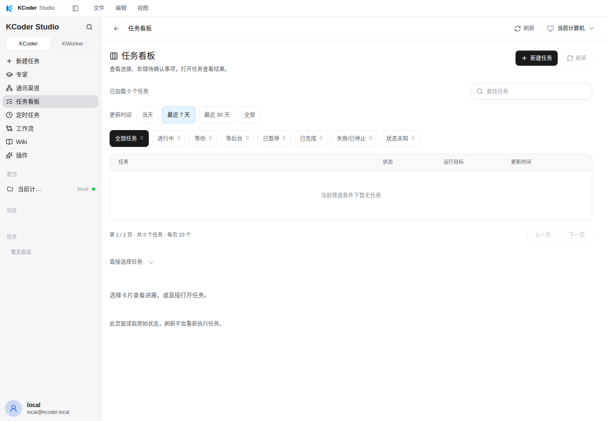
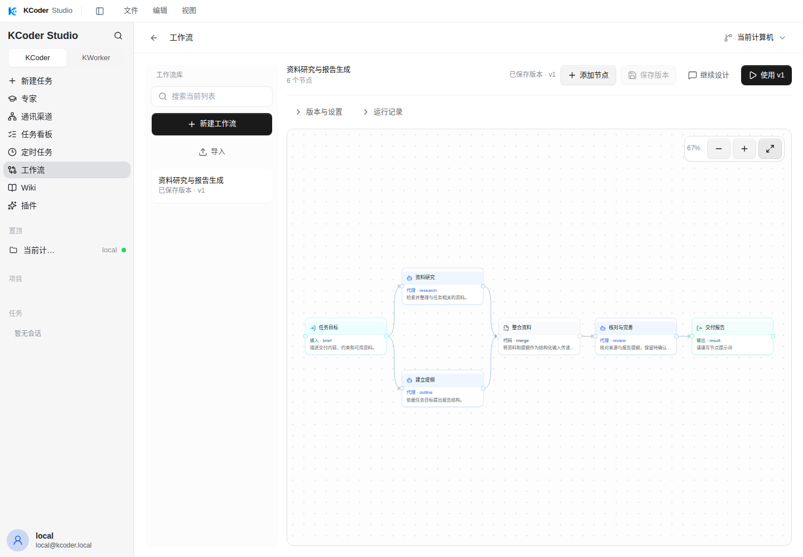
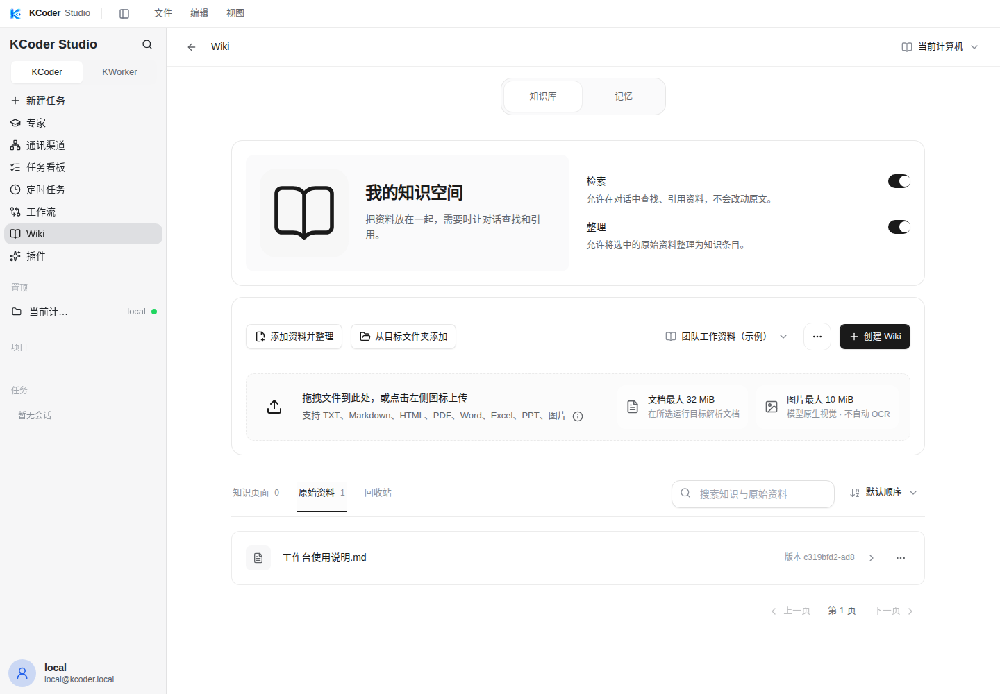

<p align="center">
  
</p>

<p align="center">
  <strong>昆仑元（KunlunMeta）</strong><br>
  围绕人工智能基础设施、大模型与智能体，研发面向实际工作场景的产品和服务。<br>
  KCoder 由昆仑元人工智能科技（上海）有限公司开发。<br>
  <a href="https://www.kunlunmeta.net/">公司官网</a>
</p>

# KCoder

**在一个工作台里处理代码、资料和多步任务。**

当前版本：2.0.9。Windows 提供 Studio 安装包；Linux 可从源码安装 CLI/TUI。其他平台的构建入口与已发布产物分别说明，下载前请核对发布记录。

KCoder 提供 Studio 图形界面和 CLI/TUI 终端入口。你可以描述目标、附上资料，让助手读取文件、运行工具、搜索网页并推进任务；也可以选择专家、复用工作流，或在原会话中继续已有工作。本机和远程运行目标分别管理模型、工具、文件与历史。

[下载与发布记录](https://github.com/yixuanchen189756-source/KCoder/releases) · [GitHub](https://github.com/yixuanchen189756-source/KCoder) · [Gitee](https://gitee.com/kunlun-meta/Kcoder) · [反馈问题](https://github.com/yixuanchen189756-source/KCoder/issues)



*以下截图来自当前 Studio 的隔离演示环境，使用示例资料和专家配置，不包含私人会话或凭证。截图展示界面，不代表任务已执行或外部平台已接通。*

## 能做什么

- **处理工程任务**：阅读和修改项目文件、运行命令、定位问题、检查改动，并在会话中查看过程与结果。
- **处理资料任务**：切换到 KWorker，整理文档、分析表格、研究资料或制作内容，使用当前目标开放的工具完成交付。
- **使用专门的专家**：创建自己的专家，或从内置模板与市场选择配置；保存固定版本后，在任务输入栏选择使用。
- **通过通道接入任务**：在通讯渠道中管理连接、核对真实聊天，并将聊天绑定到已有任务。专家是任务的可选配置。
- **联网核对资料**：搜索相关来源、读取网页及指定章节，并在会话中区分搜索摘要、已读原文和部分读取。
- **推进长程任务**：将任务拆解给子代理，查看各自进度，在原会话中继续跟进和汇总结果。
- **复用工作方法**：在工作流中编排步骤、保存版本；需要定时执行时，选择已保存的工作流或直接描述任务。
- **积累资料与偏好**：用 Wiki 管理资料和知识页面，用记忆保存经过确认、可跨会话使用的偏好与约定。
- **接续已有工作**：从 Claude Code 或 Codex 发现并迁入受支持的历史会话，核对内容后在 KCoder 中继续。
- **扩展可用工具**：通过插件、Skills、MCP 和工具设置按需扩展能力；在支持的 Windows 桌面上，经授权后还可使用 Computer Use。

具体可用的模型、工具、文件和桌面能力取决于所选运行目标及其权限。原始资料和迁入历史不会因为查看而自动执行。

## KCoder 与 KWorker

| 模式 | 适合的任务 | 示例 |
| --- | --- | --- |
| **KCoder** | 编程、代码审查、项目维护和问题排查 | “检查这次改动，运行相关测试并解释失败原因。” |
| **KWorker** | 文档、表格、资料研究和日常工作 | “根据会议纪要整理行动项，未确认的责任人标为待确认。” |



在输入框说明目标、提供必要材料，并写明希望得到的结果。文件读取、编辑和生成能力取决于当前目标的工具、技能与运行环境；收到文件后，可以继续在原会话中提出修改要求。

## 专家：保存自己的工作方法

专家保存一套身份说明、任务指令、技能与可选配置。你可以在“我的专家”里新建、编辑，也可以从内置专家或市场中选择模板。



普通任务也可以使用专家：点击输入栏的 **专家选择**，先选专家，再选已保存版本并确认。需要执行时再发送任务要求；已有任务的专家变更从下一轮生效，原历史继续保留。选择“不使用专家”可继续普通任务。



专家配置不会自动授予额外工具或权限。模型、工具设置和执行授权仍由原任务及运行目标管理。

## 通讯渠道：连接聊天与原任务

通道页面提供飞书、QQ、微信、企业微信等接入入口。先添加并认证连接，再核对连接识别到的真实私聊、群聊或话题；需要让聊天进入已有任务时，从任务中选择对应聊天并完成绑定。

连接状态、聊天绑定和后台运行授权分别显示。连接成功不会自动创建任务；后台运行需要单独授权。各平台的登录方式和支持范围以实际版本与页面提示为准。

## 任务与工作流

任务看板集中显示原任务的状态和更新时间。可按 **当天、最近 7 天、最近 30 天、全部** 筛选，默认最近 7 天，每页显示 10 项；也可以搜索标题、筛选状态，再打开原任务查看进度。



多个子代理可以分别处理独立工作，由主任务汇总。工作流则适合把经常重复的步骤保存下来：在画布中编排步骤、保存版本，之后可在定时任务中选择已保存版本，或直接描述要定时执行的任务。保存工作流不会自动执行；定时任务需要明确创建，执行取决于目标在线状态和权限。



## 联网查资料

在普通会话里直接提出问题，例如：“查找 Python asyncio 任务取消的官方说明，解释取消如何传递，并附来源。”搜索会自动选择允许的内置来源；网络或某个来源暂时不可用时，在允许范围内尝试备用来源。无需另行配置搜索服务。

来源区分“仅摘要”“已读取”“部分读取”和“无法读取”，并保留实际抓取时间、上游提供的发布日期及缓存状态。可以打开原网页核对；HTML 链接带有章节锚点时，会读取对应的可见章节。来源卡片不表示内容已经自动核实为事实。

WebSearch 和 WebFetch 的开关仍在 **设置 → 工具** 中，按 KCoder/KWorker 分别管理，修改只影响新会话。网页不会自动存入 Wiki 或记忆。

## Wiki 与记忆

**Wiki** 保存原始资料、整理后的知识页面及引用，适合在任务中查找和引用文档。支持上传文件或从目标文件夹添加资料；检索与整理有独立开关，可以分别控制。

**记忆** 保存用户确认的长期偏好和约定。导入资料和模型建议先进入候选，确认并启用后再使用。知识库与记忆在 Wiki 页面中分别管理。



## 开始使用

### Windows：安装 Studio

1. 在[发布页面](https://github.com/yixuanchen189756-source/KCoder/releases)下载 Windows x64 安装包，按提示安装并启动。
2. 打开 **设置 → 模型**，填写服务地址和凭证。服务支持模型列表时，可以直接拉取并选择模型；也可手动填写。
3. 默认使用 **当前计算机**。选择工作区；需要在远程机器执行时，再切换到已配置的远程目标。
4. 选择 **KCoder** 或 **KWorker**，描述任务并发送。需要授权时按界面提示确认。

已有安装可直接运行新安装包覆盖升级。安装器会先处理该安装所属账户的运行进程，保留配置和会话；安装前请保存正在进行的工作。下载页同时提供 SHA256 和构建信息，版本号相同的更新包也可能包含不同修复。

Windows 桌面控制需要对应组件与单独授权；SSH 文件和终端权限不会自动授予本机桌面控制权限。不同平台和安装包的可用能力以实际发布记录为准。

### Linux：从源码安装 CLI/TUI

准备 Rust 1.95 及构建依赖；Linux 的 Secret Service 支持还需要相应开发库，例如 Debian/Ubuntu 的 `libdbus-1-dev`。

```bash
git clone https://github.com/yixuanchen189756-source/KCoder.git
cd KCoder
scripts/install/installers/cli-release.sh
export PATH="$HOME/.local/bin:$PATH"
kcoder --version
kcoder
```

也可以在 Windows PowerShell 中从源码安装终端版：

```powershell
git clone https://github.com/yixuanchen189756-source/KCoder.git
Set-Location KCoder
.\scripts\install\installers\cli-release.ps1
$env:Path += ";$env:LOCALAPPDATA\Programs\KCoder\bin"
kcoder.exe --version
```

CLI/TUI 使用 `kcoder` 命令，不提供 Studio 的 KWorker 界面。运行 `kcoder --help` 或在 TUI 中输入 `/help` 查看当前版本支持的命令。

CLI 可通过配置文件连接自己的模型服务。下面的地址和模型名需要替换为实际值：

```json
{
  "active_provider": "my-provider",
  "providers": {
    "my-provider": {
      "api_format": "openai_chat_completions",
      "endpoint": "https://your-provider.example/v1",
      "default_model": "your-model",
      "context_window_tokens": 131072,
      "max_output_tokens": 8192,
      "output_headroom_tokens": 8192
    }
  }
}
```

额度示例需要按实际服务调整；上下文窗口、输出上限和输出预留均应明确配置。使用 `kcoder config path` 查看配置位置，再运行 `kcoder auth login --provider my-provider` 安全输入密钥，最后使用 `kcoder doctor` 检查配置。

### 从外网连接自己的主机

Gateway 接收 Studio、浏览器和手机的请求并验证身份，实际模型和工具运行在选定目标。Relay 帮助无法直接连接的设备穿过网络到达 Gateway，不承担模型执行。

多 Gateway Relay 按身份自动派生独立 HTTPS 子域，并保留 `/g/<id>/` 挂载路径。部署管理员需一次性配置通配 DNS，并满足证书签发的公网 443 条件；普通设备使用生成的配对链接或二维码。旧共享域名的浏览器凭据不会自动迁入新域，需要时重新配对。升级客户端并不等于云端 Relay 已完成部署。

### 迁入 Claude Code 或 Codex 会话

在 Studio 的迁移入口选择来源，发现并核对可迁入的历史，再确认保存。受支持的完整历史可创建接续会话，使用目标当前的模型、工具和权限继续工作。历史中的工具调用作为记录保留，不会因为迁移而自动重放；无法识别或不完整的内容会提示检查。

## 配置与使用边界

- 模型服务需要有效的地址、凭证和模型；凭证应存入配置支持的安全存储，不要粘贴到聊天或提交到仓库。
- 本机和远程目标拥有各自的文件、配置、凭证与历史，远端路径不会自动变成本机路径。
- 模型输出、工具执行、文件生成和业务验收是不同步骤。对关键数据、引用和最终文件请实际核对。
- 详细的源码、配置、运行与恢复说明见完整仓库的 `docs/README.md`；公开快照可能不包含内部文档。

## 许可与反馈

代码许可见 [LICENSE](LICENSE)；第三方组件保留各自的许可和归属。

反馈问题时，请说明版本、运行目标和复现步骤，并移除密钥、账号凭证与私人材料。
